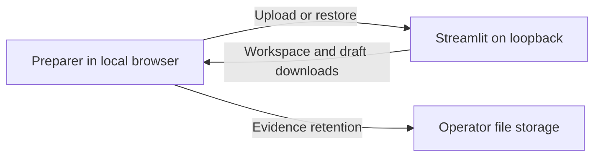
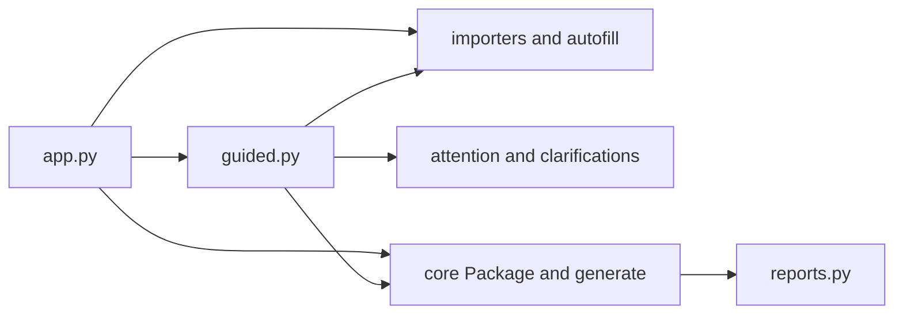
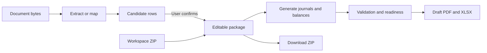

# System architecture

- Product: Otto Financial Report Engine
- Document version: 1.0
- Last updated: 2026-11-20
- Status: Verified
- Owner: Engineering
- Related requirements: OTTO-BASE-001, OTTO-DOC-001, OTTO-ACCT-001, OTTO-SEC-001
- Sources/evidence: START_ON_MAC.command, requirements.txt, app.py, guided.py, engine/

## Purpose and scope

Describe the shipped local process and the proposed boundaries.

## As-is implementation (evidence-backed)

| Layer | Files | Responsibility |
| --- | --- | --- |
| Launch | `START_ON_MAC.command`, `requirements.txt` | zsh launcher checks Python, sets up a requirements-hash-based virtualenv, runs loopback Streamlit port 8501 with usage statistics disabled. |
| Entry and UI | `app.py`, `guided.py`, `assets/` | Streamlit owns one session `Package`. Guided and Advanced use the same package. |
| Intake | `engine/importers.py`, `engine/autofill.py` | Parse with pdfplumber, openpyxl, xlrd and Python CSV. Map, propose and check rows and statements. |
| Books and diagnostics | `engine/core.py`, `engine/attention.py`, `engine/clarifications.py` | ZIP/CSV/JSON, Decimal ledger derivation and validation, routing and client questions. |
| Output | `engine/reports.py`, `run_demo.py` | ReportLab A4 PDF and XlsxWriter workbook, including command-line demo route. |
| Fixtures and support | `make_examples.py`, `make_guided_example.py`, `sample_company/`, `example_imports/`, `demo_output/`, `tests/` | Fixture generators, sample accounting data, PDFs, CSV, workbook and ZIP, seven test modules. |

## To-be requirements

Separate raw evidence retention, staged extraction, approval, append-only journal, period snapshot and report runs. Use stable IDs across boundaries. Keep optional inference behind a reviewer queue. For hosted evaluation, place identity and tenant isolation between the browser and storage and validate access on every read/write.

## Acceptance criteria / verification

Relaunch from ZIP into the same balances and evidence references. Reject a failed or unsupported parse without changing the package. Confirm unauthenticated external network access is unavailable in the documented local launcher configuration.

## Risks, limitations and open questions

Browser sessions and downloads cross confidentiality boundaries. Package dependencies have version ranges. A manual Streamlit launch can use configuration different from the Mac launcher.

## Related documents

- [Data Model](04_DATA_MODEL.md)
- [Document Extraction](06_DOCUMENT_EXTRACTION.md)
- [Security And Privacy](17_SECURITY_AND_PRIVACY.md)
- [Test Strategy](18_TEST_STRATEGY.md)
