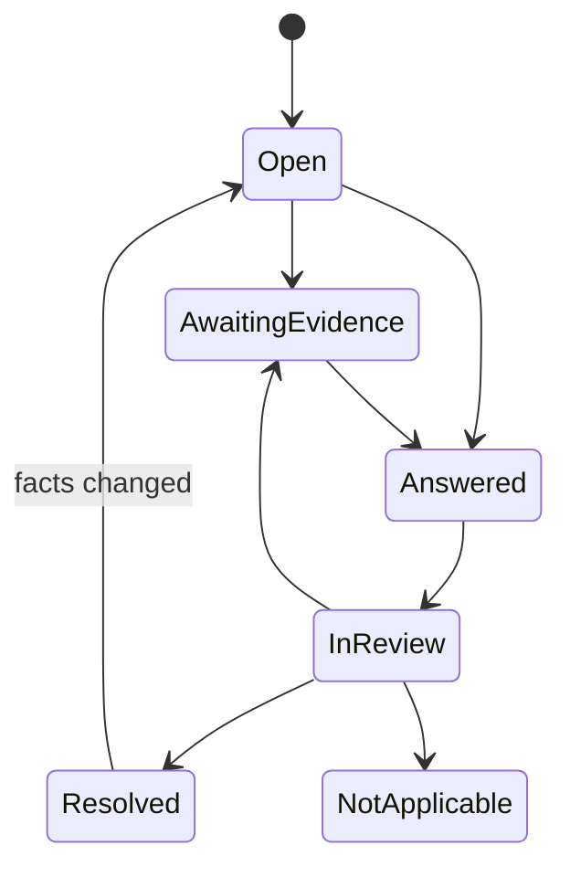

# Clarification engine

- Product: Otto Financial Report Engine
- Document version: 1.0
- Last updated: 2026-11-20
- Status: Draft
- Owner: Product
- Related requirements: OTTO-CLAR-001, OTTO-UX-002
- Sources/evidence: engine/clarifications.py:16–206, engine/attention.py:43, guided.py:137–218, tests/test_clarifications.py

## Purpose and scope

Collect answerable requests that reduce uncertainty while protecting review and posting controls.

## As-is implementation (evidence-backed)

Question ID combines trigger kind with a truncated source hash. Records include question, reason, request, priority, masked source, section and audience. Setup, statement gaps, first balances, missing rows, classification and other-record checks raise contextual questions. Guided stores status and answer in config. Answered and Not applicable leave the outstanding list. PDF and CSV export support client follow-up. Routing preserves core accounting errors when answers change.

## To-be requirements

Store stable question ID, source/transaction/account link, affected report, severity, response type, evidence needed, response, owner/reviewer, asked/answered/reviewed dates, status and resolution link. Use blocking for missing evidence that affects material balances, warning for reviewable classification/disclosures and information for optional context. Example questions: “Can you provide the bank statement covering January?” and “Was this SGD 80 paid by the company or personally by a director?” Require independent review before closure of a material issue.

A corrective action is a separate, approved mapping, journal or evidence confirmation linked to the resolution. An answer status change alone leaves the ledger unchanged. Client PDFs disclose only that recipient's requests and necessary details. Workbook-compatible exports carry IDs, status and dates with client-safe fields.

## Acceptance criteria / verification

Save and restore answers, validate exact ledger equality on edit, keep mandatory readiness blocked until evidence is reviewed, and verify source-specific links and client masking. Test CSV spreadsheet formula handling.

## Risks, limitations and open questions

Acknowledging a question can affect readiness lists earlier than substantive review. Current tracker lacks reviewer audit history and complete links. CSV values need formula-injection review.

## Related documents

- [Data Model](04_DATA_MODEL.md)
- [User Workflows Ux](08_USER_WORKFLOWS_UX.md)
- [Report Specifications](10_REPORT_SPECIFICATIONS.md)
- [Test Strategy](18_TEST_STRATEGY.md)
