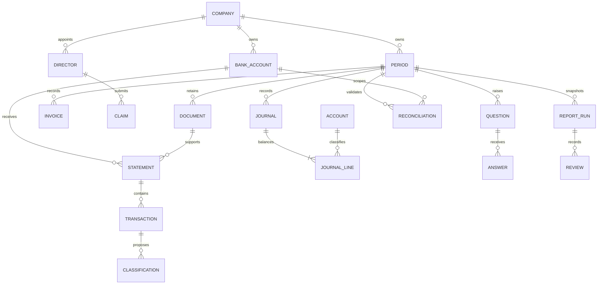

# Data model

- Product: Otto Financial Report Engine
- Document version: 1.0
- Last updated: 2026-11-20
- Status: Draft
- Owner: Engineering
- Related requirements: OTTO-UX-002, OTTO-ACCT-001, OTTO-ACCT-003, OTTO-CLAR-001
- Sources/evidence: engine/core.py:87–132, engine/importers.py:23–37, guided.py:137

## Purpose and scope

Define stored versus derived records and the migration target.

## As-is implementation (evidence-backed)

| Record | Fields and relationships |
| --- | --- |
| company.json | Name, UEN, type, address, activity, FY dates, framework, currency, confirmations, bank statement balances, configured directors with liability account, reviewer text and nested clarification responses. One company and active period. |
| bank.csv | Date, description, reference, deposit, withdrawal, account code, evidence reference, notes. Bank account implicit as 1000. |
| claims.csv | Claim ID, date, director name, merchant, description, amount, expense account, evidence reference, notes. |
| journals.csv | Journal ID, date, account code, debit, credit, description, evidence reference. One row per line. |
| invoices.csv | Invoice number and date, due date, customer, amount, paid amount, evidence reference. AR reconciliation schedule. |
| evidence.csv | Evidence reference, document type, source filename, remarks, review status. Source binaries and page coordinates are external. |
| Derived | Static COA maps type/group/cash-flow class. Ledger lines, balances, ageing, cash flow, statement summaries and validation are regenerated. No persisted report run. |

## To-be requirements

Use workspace-scoped immutable IDs. Document content hash and original coordinates identify extraction versions, then a reviewer links approved transactions to journal lines. Period holds date range, currency, framework edition, close state and comparative period reference. Statement holds account, date interval, hash and balances. Invoice and claim records have party, origin, allocations and state. Reconciliation lists timed exceptions and resolution. Report run captures snapshot ID, mapping version, totals and approval history.

## Acceptance criteria / verification

Restore older ZIP with deterministic migrations and explicit unmapped fields, retain evidence joins across row reordering, reject cross-company or cross-period links and reproduce a historical report run by snapshot.

## Risks, limitations and open questions

Bank journal IDs use row indices, references can be blank and journal IDs group across source types. Configuration is a plain dictionary. Review identity, workspace IDs and period locking are proposed.

## Related documents

- [System Architecture](03_SYSTEM_ARCHITECTURE.md)
- [Accounting Rules](05_ACCOUNTING_RULES.md)
- [Clarification Engine](09_CLARIFICATION_ENGINE.md)
- [Security And Privacy](17_SECURITY_AND_PRIVACY.md)

## Proposed Otto Auto model extension (21 November 2026)

Future model additions require raw-source hash, entity/account/period identity, field-level source provenance, staged extraction confidence, AI candidate ID, human decision, exception lifecycle, report snapshot/revision and readiness status. Do not mutate approved journals when an inference changes. Existing v1.3.1 data model remains authoritative until implementation. See [Otto Auto specification](25_AI_FIRST_AUTO_EXPERIENCE.md).
